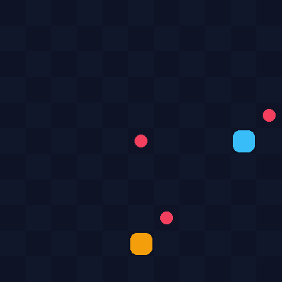
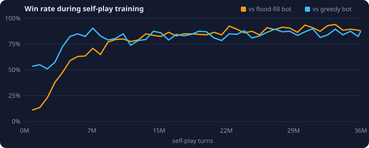
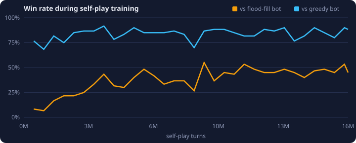

# Snake, learned by playing itself

Neural networks that learned [Battlesnake](https://play.battlesnake.com) purely through
**self-play reinforcement learning**, both head-to-head and in a free-for-all arena of up to
8 snakes. They never saw a human game, and they run live in the browser: watch them play,
or try to beat one.

**[▶ Play the live demo](https://lambdaak.github.io/SnakeDQN/)**



## Results

The final network, evaluated over 1,000 fresh games against each hand-written bot
(11×11 board, 95% Wilson confidence intervals):

| Opponent | Win | Draw | Loss |
|---|---|---|---|
| Flood-fill bot (strongest scripted: space-aware, avoids losing head-to-heads) | **91.4%** (89.5–93.0) | 0.4% | 8.2% |
| Greedy bot (chases the nearest food safely) | **90.2%** (88.2–91.9) | 6.4% | 3.4% |
| Safe-random bot | **99.4%** (98.7–99.7) | 0.2% | 0.4% |

For reference, flood-fill beats greedy only 74% of the time. The network learned from
nothing but a +1/−1 win/loss signal, plus a small bonus for eating. It ended up clearly
stronger than both hand-written strategies after about 34M self-play turns, which took
2.5 hours on a laptop (Apple M3 Max).



### Arena: 6 snakes on a 19×19 board

A second network plays free-for-all games. It reads a 17×17 window around its own head,
plus a wall channel, so it isn't tied to one board size or snake count. It was trained
with 6 snakes and extra food, for about 16M turns over 2.5 hours. In each test game it is
one snake against 5 copies of a scripted bot, so an even contest would win 16.7% of the time.

| Opponents (×5) | Win | 95% CI |
|---|---|---|
| Flood-fill bots | **44.7%** | 39.1–50.3 |
| Greedy bots | **88.0%** | 83.8–91.2 |
| Safe-random bots | **98.7%** | 96.6–99.5 |

300 games each.



## How it works

**1. A fast, verified simulator.** `snake_rl/env` implements the standard Battlesnake
rules in vectorised NumPy: simultaneous moves, health, growth, and head-to-head collisions
won by the longer snake. It steps 1,024 games at once at over 200,000 turns per second.
- Every rule has a unit test.
- The batched engine is checked move for move against an independent, deliberately
  simple reference implementation.
- Batched results match one-game-at-a-time results exactly.

**2. Self-play PPO.** `scripts/train_selfplay.py` trains a convolutional actor-critic (2M
parameters).
- **Input:** the board as 8 egocentric feature planes: own head, body and body age;
  enemy heads and bodies; enemy heads that would win a head-on collision; food; and health.
- **Opponents:** in 70% of games the network plays itself, and both seats generate
  training data. The rest are against a pool of frozen past versions, so it can't forget
  how to beat older strategies.
- **Illegal moves:** moves that would hit a wall or a body are masked out.
- **Checkpoints:** every 25 iterations the network is tested against the scripted bots,
  and the best checkpoint is kept.

**3. In the browser.** The network is exported to ONNX and runs client-side with ONNX
Runtime Web (`web/`). The rules are ported to JavaScript and checked against thousands of
Python-generated game steps (`tests/test_js_parity.py`), so the demo is exactly the game
the network trained on. The side panel shows the network's move probabilities and value
estimate live.

## Run it yourself

```bash
uv run pytest                                                   # test suite
uv run python scripts/play.py --opponent flood_fill             # terminal play vs a bot
uv run python scripts/evaluate.py flood_fill greedy             # bot vs bot, 500 games

uv sync --group train                                           # PyTorch + ONNX
uv run --group train python scripts/train_selfplay.py --device mps --hours 2.5
uv run --group train python scripts/final_eval.py runs/selfplay/best.pt --games 1000
uv run --group train python scripts/build_web_assets.py --run-dir runs/selfplay \
    --final-eval results/ppo_selfplay.summary.json             # -> web/model.onnx, web/stats.json

# arena network (any board size / snake count)
uv run --group train python scripts/train_selfplay.py --run-dir runs/arena --board 19 \
    --num-snakes 6 --window 17 --min-food 6 --hidden 128 --num-envs 256 --device mps --hours 2.5
python3 -m http.server --directory web 8000                     # demo at localhost:8000
```

To embed the demo on another site, add `?embed=1` to the URL for a compact
board-and-panel view:

```html
<iframe src="https://lambdaak.github.io/SnakeDQN/?embed=1" width="100%" height="760" style="border:0"></iframe>
```

## Layout

```
snake_rl/env/        rules, observations, rewards, batched SnakeEnv, terminal renderer
snake_rl/baselines/  random, safe_random, greedy, flood_fill, hamiltonian bots
snake_rl/agents/     CNN actor-critic and a policy wrapper for the evaluation harness
snake_rl/eval/       match runner with confidence intervals
scripts/             train, evaluate, export, play, benchmark, render GIF
web/                 browser demo (static; deployed to GitHub Pages)
results/             evaluation JSON and the full training log
tests/               pytest suite, including Python ↔ JavaScript rule parity
```
